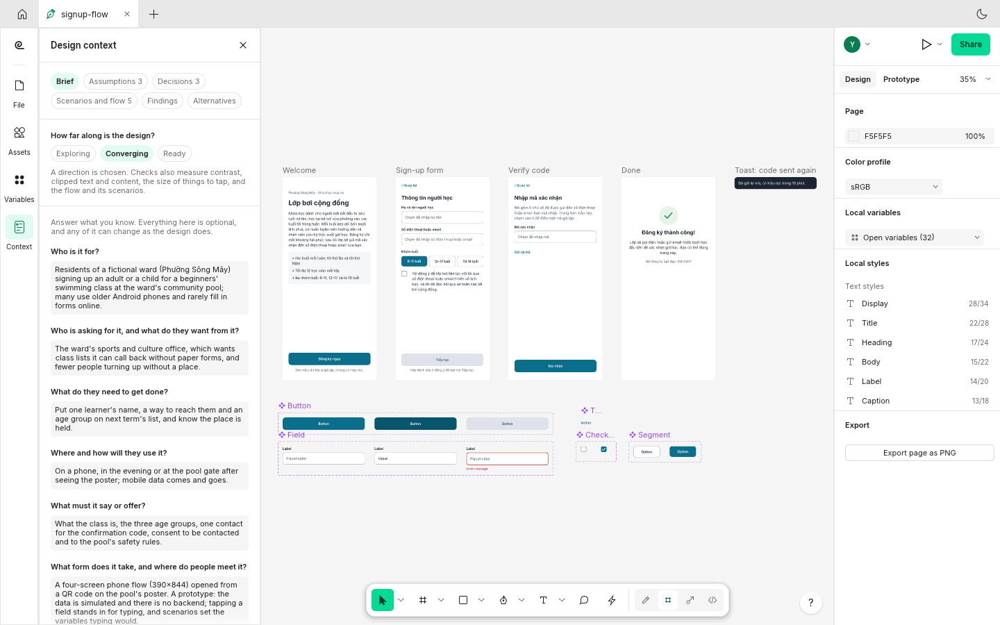
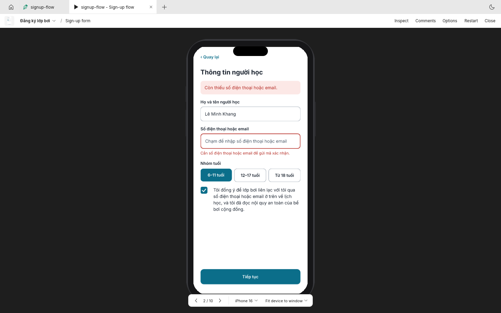
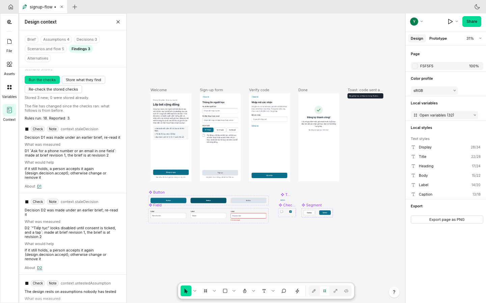
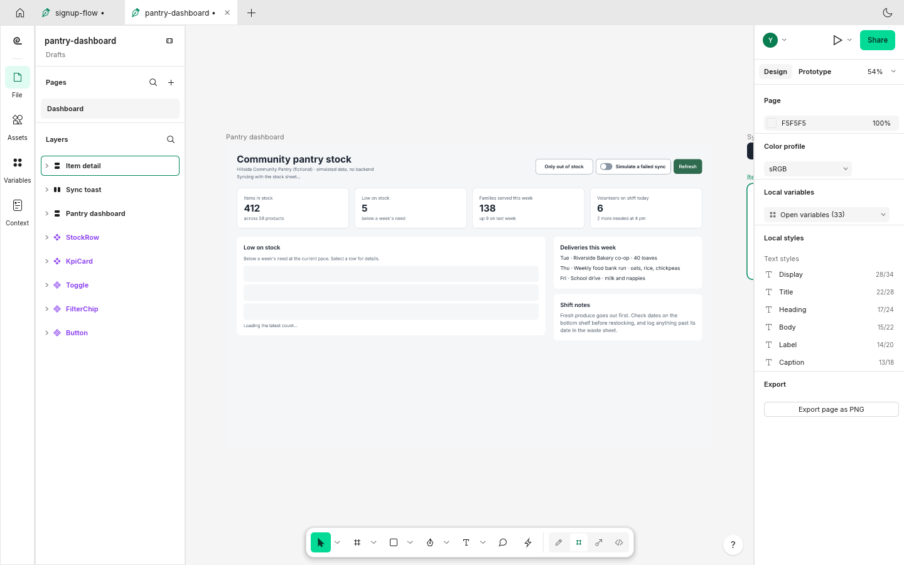
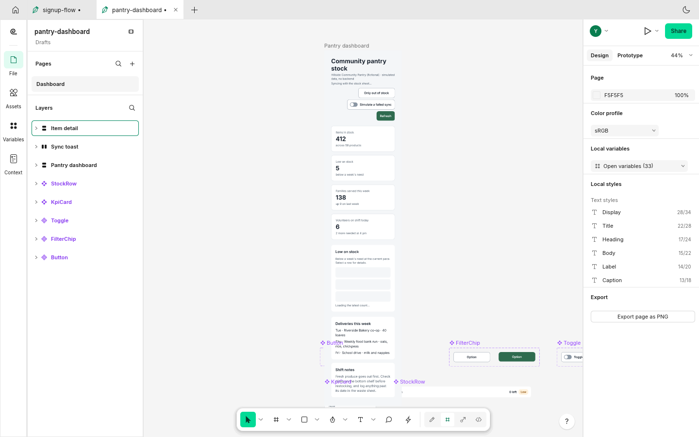
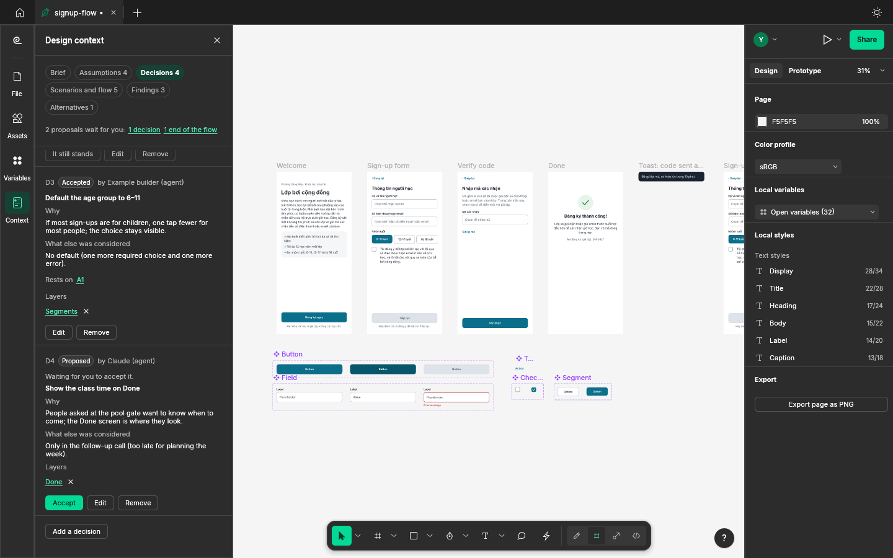

<h1 align="center">Figgure My UI</h1>

<p align="center">
  <b>Design interactive UI prototypes together with an AI agent, and check that they work.</b><br>
  A native, open-source design tool in Rust where a person and an agent (Claude Code, Codex or any MCP client)<br>
  build screens from real components and variables, wire real interactions, run the flows, and fix what fails.
</p>

<p align="center">
  
  
  
</p>

> [!NOTE]
> **Figgure My UI is a fork of [FigCraft](https://github.com/storytold/figcraft)**, an open-source
> interface design tool made by the ArtCraft team and its contributors. It is not made or endorsed by
> them. The rename is not done yet: **the app, its window, its binaries (`figcraft`, `figcraft-cli`)
> and its file format (`.figcraft`) still carry the FigCraft name**, and this README uses those names
> where you type them.

<p align="center">
  
  <br><sub>The sign-up example with its <b>Design context</b>: the brief, written as plain questions, sits in the file next to the screens it explains · <code>examples/signup-flow.figcraft</code></sub>
</p>

## What it is for

You describe what you need (who it is for, what they must get done, where), maybe with content or
reference images, to an AI agent. The agent connects to the app over MCP, reads what is already in
the file, and builds the prototype out of real structure: frames with auto layout and constraints,
text, components and variants, variables, and interactions. You watch it happen in the app and edit
it yourself at any point. Then the agent **runs** the prototype's flows headless, sees what state each
step leads to, checks the design against measured rules, fixes what fails, and saves. The file you
reopen tomorrow still has the screens, the behaviour, the scenarios and the reasons.

What is new in this fork, on top of FigCraft's editor:

- **Design context in the file**: a brief (who, who is asking, the job, the situation, the content, the
  form, the tone, what can't change, how success would show), assumptions marked untested / supported /
  refuted with their evidence, decisions with their rationale and rejected options, all linked to the
  screens and components they concern. A person reads and edits all of it in the **Design context**
  panel; an agent through commands. The brief never blocks work: every field is optional.
- **Prototype verification without a window**: a simulator follows the same rules as the app's
  player (a parity test drives both with the same files and steps; the
  [remaining differences](docs/mcp.md#design-context-and-verification) are listed in every result).
  `proto.check` reports the flow as facts: starts, reachable screens, broken targets, dead ends
  against the screens you declared as ends, trapped overlays. **Scenarios** stored in the file walk
  the prototype step by step and check the screen, overlays, variables, variants, visible layers and
  text after each step.
- **Checks that measure, and a fix loop that re-measures**: text contrast (WCAG 2.2 SC 1.4.3), target
  size (SC 2.5.8 / 2.5.5), clipped text and content, broken links in the design context, and the flow
  and scenario rules. A finding records the layers, the rule, the evidence and a suggestion; it is
  closed only when its rule passes again, never because someone said it was fixed. Opinions
  (`judgement`) and what a person said (`feedback`) are kept apart from measurements. There is no
  "design score" anywhere.
- **Alternatives with stated constraints**: copies of a screen made under a stated constraint, kept
  next to the original, compared as a table of facts (structure, reading order, content, actions,
  density) that flags a copy that only changed colours. Nothing is ranked; a person chooses.
- **Agents propose, people settle**: an agent's decisions, end states and choices stay *proposals*
  until you accept them in the panel. The engine refuses an agent marking an assumption supported,
  accepting its own proposal, dismissing a finding, closing your feedback, undoing your steps,
  throwing away your unsaved work, or editing while you are in the middle of a drag or a text edit.
  These rules are a convention between cooperating parties, not a security boundary (see
  [Limits](#limits-read-this)).
- **An MCP server built for this loop**: `get_capabilities`, a fixed *working document* (an agent never
  edits a tab you happened to bring to the front), a revision in every result and `ifRevision` to
  refuse a change if you edited the file since the agent last read it, structured errors with codes,
  tools for the design context, checks, flow facts, scenarios and a picture of a simulated state, and
  prompts that teach the working method.

Three original example prototypes show it end to end ([`docs/examples.md`](docs/examples.md)): a
Vietnamese sign-up flow with validation, a responsive dashboard with loading, empty and error states,
and a multi-step booking flow with back and change. Every scenario in them passes, headless and when
played by hand.

<table>
<tr>
<td width="50%" valign="top">
  
  <p align="center"><sub><b>Real states, reached by real clicks</b>: the sign-up form's validation error in the player</sub></p>
</td>
<td width="50%" valign="top">
  
  <p align="center"><sub><b>Findings with evidence</b>: what was measured, by which rule, and which rules didn't run at this stage</sub></p>
</td>
</tr>
<tr>
<td width="50%" valign="top">
  
  <p align="center"><sub><b>Responsive by constraints and auto layout</b>: the dashboard at 1440 px …</sub></p>
</td>
<td width="50%" valign="top">
  
  <p align="center"><sub>… and the same frame resized to 360 px: nothing redrawn by hand</sub></p>
</td>
</tr>
<tr>
<td colspan="2" valign="top">
  
  <p align="center"><sub><b>Agents propose, people settle</b>: an agent's decision waits in the panel until a person accepts it</sub></p>
</td>
</tr>
</table>

## Get started

There are no release downloads of this fork yet. Build it from source (Rust 1.95 or newer):

```bash
git clone https://github.com/vansyson1308/figguremyUI
```

```bash
cd figguremyUI
```

```bash
cargo build --release -p figcraft -p figcraft-cli
```

This gives you the desktop app `target/release/figcraft` (`figcraft.exe` on Windows) and the
command-line tool `target/release/figcraft-cli`, which also runs the MCP server. A first build takes
a while; after that you run the binaries directly, no rebuild per session.

On Linux the app needs the usual desktop libraries (for example on Debian/Ubuntu:
`libxkbcommon-x11-0`, `libwayland-client0`, `libgl1`). Text uses your installed fonts; the examples
are set in [Inter](https://rsms.me/inter/), so install it for them to look as designed. Optionally,
clone [craft-fonts](https://github.com/storytold/craft-fonts) next to this repository before building
so fonts are built into the binaries.

Open an example:

```bash
target/release/figcraft examples/signup-flow.figcraft
```

Open **View ▸ Panels ▸ Design context** (or the **Context** button on the left rail) to see its brief,
assumptions, decisions, scenarios and checks, and press the ▶ button at the top right to play it.

## Connect an AI agent

The MCP server is the same binary in two modes:

| Mode | Command | What it does |
|---|---|---|
| **Headless** | `figcraft-cli mcp` | An engine session with no window. Fast, good for building and checking files; nobody sees it live. There is no player window: verify flows with the simulator tools. |
| **Attached** | `figcraft-cli mcp --attach 7979` | Drives the app you started with `figcraft --control 7979`. You see every change as it happens and can edit at the same time; the agent's changes are its own undo steps, and `ifRevision` stops it overwriting what you just did. |

The control channel listens on 127.0.0.1 only. To keep an agent to certain folders, start the
headless server (or, for attached mode, the app) with `--automation-read-root DIR` and
`--automation-write-root DIR`.

These clients run the server as a local process on your computer. A client that runs in the cloud
(for example a web or remote session) runs in its own machine: it can't start a binary on your
computer or reach your localhost unless you connect them some other way; the vendors' documentation
doesn't promise that it can.

### Claude Code

From the folder you work in (replace the path with the absolute path to your binary):

```bash
claude mcp add --transport stdio figcraft -- /path/to/figguremyUI/target/release/figcraft-cli mcp
```

Attached to the running app instead (start the app first with `figcraft --control 7979`):

```bash
claude mcp add --transport stdio figcraft-app -- /path/to/figguremyUI/target/release/figcraft-cli mcp --attach 7979
```

Add `--scope user` to have it in every project, or `--scope project` to write it to the project's
`.mcp.json` for everyone who clones it. Check it with `claude mcp list`, or `/mcp` inside Claude Code.
The same server in a project's `.mcp.json`:

```json
{
  "mcpServers": {
    "figcraft": { "command": "/path/to/figguremyUI/target/release/figcraft-cli", "args": ["mcp"] }
  }
}
```

Source: [Claude Code MCP documentation](https://code.claude.com/docs/en/mcp) (checked 2026-11-13).

### Codex

```bash
codex mcp add figcraft -- /path/to/figguremyUI/target/release/figcraft-cli mcp
```

Or in `~/.codex/config.toml` (shared by the Codex CLI and its IDE extension):

```toml
[mcp_servers.figcraft]
command = "/path/to/figguremyUI/target/release/figcraft-cli"
args = ["mcp", "--attach", "7979"]
tool_timeout_sec = 120
```

Check it with `codex mcp list`, or `/mcp` inside Codex. Source: [Codex MCP documentation](https://developers.openai.com/codex/mcp) (checked 2026-11-13).

### Claude Desktop

Settings ▸ Developer ▸ Edit Config opens `claude_desktop_config.json`; add the server and restart
Claude Desktop:

```json
{
  "mcpServers": {
    "figcraft": { "command": "/path/to/figguremyUI/target/release/figcraft-cli", "args": ["mcp", "--attach", "7979"] }
  }
}
```

What was verified for this README: the MCP protocol end to end, headless (automated tests) and
attached to the real app under a virtual display (a scripted session). The client commands above
come from the clients' documentation; they were not run against each client here.

## From a request to a working prototype

Start the app with `figcraft --control 7979`, connect your agent attached, and ask, for example:

> Make a sign-up prototype for a community swimming class. It's for parents signing up a child on a
> phone at the pool gate, often on slow mobile data. They need to give a name, a phone number or
> email, pick an age group and agree to be contacted. Show what happens when something is missing.
> Use the design_from_brief method.

What a well-behaved agent does with the tools (the `design_from_brief` prompt spells this out):

1. `get_capabilities`, then `design_context`: it records your brief with `design.brief.set`, and what
   it had to guess as **untested assumptions**.
2. It looks at what is already in the file (`inspect_document`, `screenshot`) and builds on it: frames
   with auto layout, a `Field` and a `Button` component with variants, variables for the form's state,
   instances on the screens.
3. It wires interactions (navigate, back, overlays, change to, set variable, conditionals), declares
   the screen where the flow ends (a *proposal* you accept in the panel), and stores **scenarios**:
   the happy path, a missing field, going back.
4. It verifies by running: `check_prototype` (flow facts), `run_scenarios`, `simulate_prototype` with
   `image: true` to see a state, and `check_design` for the measured rules. It fixes one finding at a
   time and re-checks it.
5. It saves, and tells you what is still open: untested assumptions, proposals waiting for you, checks
   that didn't run at this stage, and what was simulated rather than played.

You can watch, edit, play it with ▶, and accept or reject its proposals in the Design context panel at
any point.

## What you get out of it

| What | Where | What it is, and what it isn't |
|---|---|---|
| **The design file** | `.figcraft` (File ▸ Save) | The editable source: pages, layers, components, variables, styles, interactions, and the design context and scenarios. Reopens as it was. |
| **The interactive prototype** | Inside the app's player (▶), or verified headless | Clickable, with real state. There is no standalone HTML or app export of the prototype. |
| **Images and documents** | File ▸ Export, `figcraft-cli export` | PNG, JPG, WebP, SVG, PDF (and Android Vector Drawable XML): static pictures of frames or layers. |
| **Code** | Developer Mode (Inspect) | CSS, HTML, React, Vue, SwiftUI, Jetpack Compose and more for a layer or component: a starting point for developers, not a running app. |
| **A production app with a backend** | — | Not produced. The examples' data is simulated; typing is stood in for by setting variables. |

To hand a design over: save the `.figcraft` file (it carries the brief, decisions and scenarios), and
ask the agent to run the `hand_over` prompt, which lists what is open. `.fig` export exists but is
experimental and drops what that format can't hold (variable and conditional actions among them;
[`docs/file-format-parity.md`](docs/file-format-parity.md)).

## Limits (read this)

- **Alpha software.** The editor underneath is FigCraft's alpha (its own assessment is in
  [`ROADMAP.md`](ROADMAP.md)). `.fig` import and export are best effort.
- **The simulator is not a person using the prototype.** It follows the player's rules for what state
  comes next, but it does not model animation timing, scroll position, drag direction, device frames
  and responsive resizing, or what overlaps what on screen; a step is one trigger. Every result says
  so (`simulated`, `notModelled`, `knownDifferences`). A passing scenario is not user research, and
  neither is an agent's review.
- **Checks measure what they can.** Contrast is measured on solid fills; text on gradients, images or
  under other layers is reported as *unmeasured*, not passed. Target size doesn't evaluate the WCAG
  exceptions. Without any font installed, text checks say they are blind.
- **Authority rules are a convention.** They stop a cooperating agent from settling things for you;
  anything with full access to the control channel or the command line acts as you.
- **Live editing by two people** merges the design context as a whole: if two people edit it at the
  same moment in a live session, the later edit wins.
- **Known open problems in the Design context panel** (being fixed; `handoff/CHECKLIST.md`): after
  you switch tabs or open another file, the panel can still show the previous file's check and
  scenario results, so run them again in the file you look at; keyboard focus can move to a control
  that is scrolled out of view; parts of the Vietnamese panel are still in English.
- **Accessibility**: the app has keyboard navigation and screen-reader names (AccessKit); the new
  Design context panel's text contrast was measured in both themes (at least 5:1 for its text) and
  Tab reaches its fields and buttons. A screen-reader pass over the new panel has not been done. In
  the dark theme, frame names on a light page are hard to read (1.9:1; open).
- **Online sharing is off by default** in this fork: Share ▸ Online needs a server you enter in
  Preferences (or run yourself, [`docs/server.md`](docs/server.md)); sharing on your local network
  works without one. Shared files are not end-to-end encrypted.
- **No release builds** of this fork yet, and the app is not yet renamed.

## Documentation

- [`docs/mcp.md`](docs/mcp.md): every MCP tool, the working document, revisions and errors, design
  context and verification, prompts and resources.
- [`docs/examples.md`](docs/examples.md): the three example prototypes and how to run their scenarios.
- [`docs/control-protocol.md`](docs/control-protocol.md) and [`docs/cli.md`](docs/cli.md): the app's
  control channel and the command line.
- [`docs/design/book-to-product.md`](docs/design/book-to-product.md): the research behind the design
  context and the agent's working method (from Frank Chimero's *The Shape of Design*, cited, not
  quoted at length).
- [`docs/acceptance.md`](docs/acceptance.md) and [`docs/benchmarks.md`](docs/benchmarks.md): what this
  milestone was checked against, and the measured performance.
- [`docs/architecture.md`](docs/architecture.md), [`AGENTS.md`](AGENTS.md): how the code is built,
  and the rules for contributors and coding agents.

## Contributing

Issues and pull requests are welcome at
[github.com/vansyson1308/figguremyUI](https://github.com/vansyson1308/figguremyUI). Read
[`AGENTS.md`](AGENTS.md) first: everything user-visible is an engine command with tests, shipped code
never panics, assets must be original or openly licensed and listed in
[`ATTRIBUTION.md`](ATTRIBUTION.md), and `cargo xtask ci` must pass.

## License and credits

Dual-licensed under [MIT](LICENSE-MIT) or [Apache-2.0](LICENSE-APACHE), at your option. Required
notices are in [NOTICE](NOTICE); the copyright of FigCraft's code stays with the ArtCraft Team and the
FigCraft contributors, whose history this repository keeps.

Figgure My UI is based on FigCraft by the ArtCraft team and community. The ArtCraft name and logos are
the ArtCraft Team's trademarks; this fork doesn't use them, and is not an ArtCraft product.

Every icon is drawn in code or made for the project, and other assets keep their own open licences;
each one is listed with its author, source and licence in [ATTRIBUTION.md](ATTRIBUTION.md).
